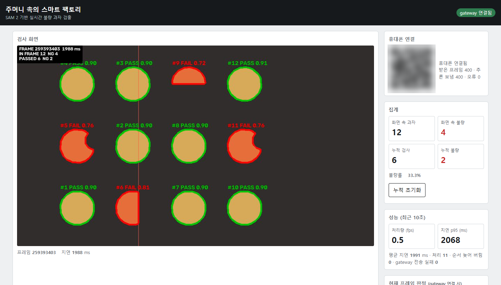

# 주머니 속의 스마트 팩토리

**SAM 2와 모바일 스트리밍 기반 실시간 불량 과자 검출 시스템**

휴대폰을 컨베이어 위에 비추면, 카메라 영상이 4단계 컨테이너를 거쳐 과자 하나하나의 외곽선을 따고 모양으로 불량을 판정한다. 결과는 PC 웹 대시보드에 마킹된 영상과 누적 집계로 실시간 표시된다.



*대시보드 — 정상 과자는 초록 `PASS`, 불량 과자는 빨강 `FAIL`. 가운데 세로선(검사선)을 지난 과자를 누적 집계한다. (임시 테스트용 합성 영상)*

## 동작 방식

```
phone ──①──▶ gateway ──②──▶ preprocessing ──③──▶ inference ──④──▶ visualizer
               ▲ │                                                    │ │
               │ └──⑥──▶ web ◀── metrics ─────────────────────────────│─┘
               └─────────────────────────── ⑤ ────────────────────────┘
```

| 구간 | 내용 |
|---|---|
| ① 휴대폰 → gateway | 대시보드 QR로 접속한 휴대폰이 카메라 프레임(JPEG)을 초당 5장 보낸다 |
| ② gateway → preprocessing | 프레임에 번호·시각을 붙여 넘긴다. 뒤가 밀리면 최신 1장만 남긴다 |
| ③ preprocessing → inference | 크기·색·대비를 보정하고, 배경과 구분되는 과자 후보 영역(박스)을 찾아 넘긴다 |
| ④ inference → visualizer | SAM 2가 박스마다 과자 외곽선을 따고, 모양을 재서 PASS / FAIL을 판정한다 |
| ⑤ visualizer → gateway | 외곽선과 판정을 영상에 그리고, 과자를 추적해 누적 집계한다 |
| ⑥ gateway → web | 마킹된 영상과 집계를 대시보드로 실시간 전달한다. 처리 속도·지연(metrics)은 대시보드가 visualizer에서 직접 받는다 |

휴대폰 카메라는 HTTPS 주소에서만 열리기 때문에, gateway가 Cloudflare 임시 터널로 실행한 PC의 HTTPS 주소를 만들어 QR에 넣는다. 처리는 모두 실행한 PC에서 하고, Cloudflare는 ① 구간만 전달한다.

## 불량 판정

SAM 2(`sam2.1-hiera-tiny`)가 딴 과자 외곽선에서 세 값을 재고, 하나라도 기준에 못 미치면 `FAIL`이다.

| 값 | 계산 | 잡는 불량 | 기준 |
|---|---|---|---|
| 볼록도 | 면적 / 볼록 껍질 면적 | 한 입 베어 문 자국, 조각 결손 | 0.975 이상 |
| 원 채움률 | 면적 / 외접원 면적 | 한쪽이 잘린 것, 반쪽 파손 | 0.95 이상 |
| 원형도 | 4π·면적 / 둘레² | 보조 기준 | 0.80 이상 |

- 화면 가장자리에 걸쳐 잘려 보이는 과자는 판정을 보류한다(`WAIT`, 회색).
- 누적 집계는 과자 중심이 검사선을 지날 때 한 번만 센다. 과자는 화면 오른쪽에서 왼쪽으로 움직인다고 가정한다.

기준값을 정한 측정 결과는 [inference README](services/inference/README.md#판정-기준)에 있다.

## 구성

| 서비스 | 역할 | 주요 기술 | 담당 | 포트 |
|---|---|---|---|---|
| [web](web/README.md) | 대시보드 | HTML·JS, nginx | 명수 | 8000 |
| [gateway](services/gateway/README.md) | QR 접속, 프레임 수신·전달, 결과 중계 | FastAPI, WebSocket, cloudflared | 우진 | 8001 |
| [preprocessing](services/preprocessing/README.md) | 보정, 과자 후보 검출 | FastAPI, OpenCV | 진아 | 8002 |
| [inference](services/inference/README.md) | 외곽선 분할, 불량 판정 | FastAPI, SAM 2, PyTorch(CPU) | 대희 | 8003 |
| [visualizer](services/visualizer/README.md) | 마킹, 추적·누적 집계, 성능 측정 | FastAPI, OpenCV | 도은 | 8004 |

모든 서비스는 Docker Compose로 함께 실행되고, 서비스끼리는 Docker 내부망에서 서비스 이름으로 통신한다. 구간별 데이터 형식은 [docs/contracts](docs/contracts/README.md)에 있다.

## 실행

**준비물**: Docker Desktop(Compose 2.24 이상), 인터넷에 연결된 PC, 휴대폰(Android Chrome 또는 iOS Safari).

```bash
git clone https://github.com/wkuMyeungsu/SAM2-Powered-Mobile-Defect-Detection-System.git
cd SAM2-Powered-Mobile-Defect-Detection-System
docker compose up --build -d     # 첫 빌드는 오래 걸린다 (inference 이미지 약 2GB)
docker compose ps                # 5개 모두 healthy가 되면 준비 완료
```

1. PC 브라우저에서 http://localhost:8000 을 연다.
2. 대시보드의 QR을 휴대폰으로 찍고 "촬영 시작"을 누른다.
3. 과자를 단색 배경 위에 놓고 휴대폰으로 비춘다. CPU로 추론하므로 결과는 약 2초 늦게 나온다.

종료는 `docker compose down`. 포트가 겹치면 `.env.example`을 `.env`로 복사해 바꾼다.

## 테스트

### 통합 테스트

[실행](#실행) 순서대로 실제 휴대폰으로 과자를 비춰, 대시보드에 판정과 누적 집계가 나오는지 확인한다. 휴대폰 카메라부터 대시보드까지 ①~⑥ 전 구간을 거치는 유일한 테스트다.

### 임시 테스트 (휴대폰 없이)

```bash
docker compose --profile test run --rm --build pipeline
```

휴대폰 대신 합성 영상을 gateway에 넣어 ②~⑥ 구간이 이어지는지만 빠르게 확인한다. 휴대폰·터널·실제 과자는 거치지 않는다. 자세한 내용은 [tests/pipeline](tests/pipeline/README.md).

## 브랜치

```
feature/<파트>/<기능> ──PR──▶ dev (통합·테스트) ──PR──▶ main (최종본)
```

- `main`과 `dev`는 GitHub 보호 규칙으로 직접 push가 막혀 있고, PR로만 합친다. 병합은 Create a merge commit만 쓴다.
- 작업 브랜치는 `dev`에서 `<태그>/<파트>/<기능>` 세 단계로 만든다.
  - 태그: `feature` `fix` `docs` `refactor` `chore`
  - 파트: `web` `gateway` `preprocessing` `inference` `visualizer`, 여러 파트를 함께 바꾸면 `common`
  - 예: `feature/web/qr-page`, `fix/inference/empty-mask`
- 커밋 메시지는 `<타입>(<파트>): <요약>`. 예: `feat(web): QR 접속 화면 추가`

작업 범위, 금지 사항, main에 올리는 절차는 [git 작업 규칙](docs/git-rules.html)에 있다.

## 문서

- [구간별 데이터 형식](docs/contracts/README.md)
- [git 작업 규칙](docs/git-rules.html)
